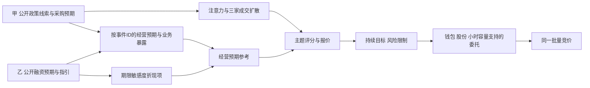

# 双市场特色合同

版本 0.3.1；2026-10-01；P0 实施冻结、待独立验收。权威数值与顺序见[精确规则](market-model-rules.md)，本文件解释该规则的市场 profile 和固定因果场景。以下均为虚构游戏初值，不是现实市场估计。

## 状态和唯一传导

世界共享需求、融资环境、风险偏好、八概念及世界时钟。行业景气按市场×行业保存，两市场同业不是一个状态。每市另有公开融资预期 `rateOutlook` 和已生效经营融资环境 `effectiveFinancing`，范围均为 Q9 的 [-1,1]，开局为0。公司公开 `durationSensitivity`、负债敏感度与业务暴露；实际 E、未公开结果与未来分支仍是私有世界状态。

政策采购/准入/需求事件的预告，只按事件ID保存带业务权重的对数经营预期。落地时用同ID结果替换；实际经营仅在生效时更新一次。`policyOutlook` 是这些有效公开预期的展示汇总，不另加入估值或评分。融资预告改变 rateOutlook；有效的融资结果到生效日才改变 effectiveFinancing。它不向交易钱包发现金，也不增加股份。



经营式在原 g 中加 `0.0002*负债敏感度*effectiveFinancing` 后执行既有±0.003裁切。该项描述公司成本环境，不是账户现金利息。公开估值的唯一扩展为：

```text
V_public = P_initial * E_forecast/100
  * exp(0.20*负债敏感度*共享融资因子
        + durationK[market]*durationSensitivity*rateOutlook)
S = alpha*fundamentalMultiplier[market]*F + beta*T_a
  + gamma*themeMultiplier[market]*H_i -0.30*Risk + scoreNoise
R = V_a,i * exp(kT*T_a + kH*themeQuoteMultiplier[market]*H_i)
```

实际已实现经营融资成本只在 E 中；期限折现是对未来融资环境的公开估值影响，不再作为事件经营预期加一遍。若事件已修改宏观/行业环境，其经营预测沿公共因子模型传导，不另设相同金额的经营事件贡献。每个模板必须声明一种主渠道；链的各节点可用不同渠道，必须用不同 effect ID。

| 参数/来源 | 甲 | 乙 | 更新/公开时点与退出 |
|---|---:|---:|---|
| durationK | .04 | .16 | profile 固定；只作用于公开融资预期 |
| fundamentalMultiplier | 1.00 | 1.15 | 对每股评分的 F 项；不改变风险上限 |
| themeMultiplier | 1.25 | .80 | H评分；关注本身无方向，Outlook仍须公开证据 |
| themeQuoteMultiplier | 1.20 | .80 | H报价项；所有风格沿用原kH |
| rateOutlook / effectiveFinancing | 0 / 0 起步 | 0 / 0 起步 | M01/M03类公告的公开窗口；预告20日内更新/核实/失效；生效结果持续到下一已公开变更 |
| durationSensitivity | 数字/健康 .8，基础设施 .6，能源/工业 .4，消费 .2 | 同生成规则 | 公司初始公开身份，Q9，范围[0,1]；首版不随价格改变 |
| 本地价值/趋势/主题/库存/噪声份额 | 28/18/20/26/8% | 40/16/12/26/6% | 股份初始化，角色数和钱包不变；不按盈亏补足 |
| 持有期与保护 | 次日、日±10% | 下一批、批±8% | 详见精确规则6.2；报价意图保留，不删区间外需求 |

政策事件使用公开有符号业务权重，默认受益权重非负；替代品/挤出方可以负，绝对值之和≤1。概念身份暴露仍非负、双标签总和≤1。业务权重必须来自事件对象的公开业务说明，不能仅按标签重复加效果。

每一版本消息记录来源模板、effect ID、公开时点、预期均值/范围、有效截止和前一版本。同批重大公告复核一次，不能更新小时容量。未复核时目标股数保留、报价使用新公共信息。跨市场账户对每股使用所属profile，共享一个现金钱包；它的行业限额跨两市合并。

## 可检验场景

完整输入见[固定场景](../../tests/scenarios/p0/market-cases.json)。下表的价格只是已有参考与有效限价，不指定未来股价。成立指传导方向与可下单条件成立，不保证盈利。

| ID | 来源及公开时间（玩家日/批） | 条件与必须观察到的方向 | 失败/退出风险 |
|---|---|---|---|
| MI-A01 成立 | S01采购公开预告10/0；O01核实18/4 | 暴露.6，预期对数.08，结果.10；同ID参考从exp(.048)变exp(.060)。不拥挤、目标低于新目标且现金足够时，主题评分/愿付提高，可形成买意图 | 成交须有卖方；甲新买仓次日才能退出 |
| MI-A02 成立 | S01产业替代政策30/0，O01落地35/0 | 受益者权重.6、替代者-.3，公开冲击.08；预期分别+.048/-.024，目标有条件地转向受益者；预算来自减仓或原现金 | 两股不能同时拿一份卖款；本批卖款下一批才可买 |
| MI-A03 失败/反向 | I01预告50/0，O01结果55/8 | 已公开预期增长10%、实际5%；真实E升到105，结果版本替换110预期，经营参考相对旧版本下降，关注可仍高 | 新闻措辞“改善”不构成买入奖励，锁仓/拥挤可妨碍退出 |
| MI-A04 失败 | S01正面公告70/4 | 买方现金为0且已有锁定仓，卖方最低1400、最高有预算买价1100；目标意愿可上调，实际新增买量为0，Q=0 | 不造资金、成交或移动保护参考；消息热度不能解冻股份 |
| MI-B01 成立 | M01融资预告10/0，S02生效15/0 | rateOutlook+.5、期限敏感.8；折现项+.064（交换甲profile为+.016）。生效前E不变；生效后负债.4贡献日g+.00004。价值资金在相同公开价下更愿配置 | 期限估值已贵、现金/容量不足时不保证成交 |
| MI-B02 成立 | I02经营指引30/0，O02兑现38/0至58/0 | 公开经营增长.08且后20日持续g=.0004；结果及覆盖后报告分别只保留未覆盖贡献；复核后配置目标逐步提高，下一次日历复核不改相位 | 后续成本恶化可抵销；长期资金仍有限 |
| MI-B03 失败/反向 | M03紧融资50/0，S02生效55/0 | rateOutlook-.5；期限.8公司估值项-.064，期限.2为-.016；相同前缀与资金下高期限更大下调，资源支持的减仓有条件出现 | 无买方则卖不出，乙可售不代表承接无限 |
| MI-B04 失败 | I01融资传闻70/0，I02证伪或90/0到期 | 传闻+.5预期无有效结果，20日内证伪/失效使该贡献归零；actual E与effectiveFinancing从未被传闻修改 | 关注可衰减而成交仍下跌/无成交，不保持永久利好 |

P3必须在实际生产目标/委托/成交路径执行这些场景，并保持资金和业务身份，交换两市profile比较。MI-B01的期限项、甲乙H评分与报价乘数应跟随profile；持有期和价格保护分别报告，不把其差异冒充政策传导。P0只用数值算例冻结方向，P3/P5才证明市场表现与决策取舍。

政策的“预期→融资条件→经营/资产估值”参照[ECB传导机制](https://www.ecb.europa.eu/mopo/intro/transmission/html/index.en.html)。该一手资料说明多渠道与不确定时滞；本游戏的两市参数、行业权重和时间尺度属于独立设计，不能据此称为真实甲/乙市场规律。

## 内容位置

[内容索引](../../tests/scenarios/p0/content-registry.json)固定24模板、6链。P3子集为O01/O02（经营），S01/S02（行业），M01/M02（宏观），I01/I02（信息），链C01/C02。M03紧融资属于P4内容，但P3的M01允许正负参数分支以完整验证MI-B03，不增加第九个模板。每个模板均有公开预期/结果/有效期字段；同模板不同符号不是新模板。C01承担甲政策与兑现/落空，C02承担乙融资、指引与持续经营；其余4链在P4按同schema补齐。代表8/2的自然结果分布、单位、文本槽、重大条件与合法分支键以[event-v1合同](event-content-contract.md)和[数据样本](../../tests/scenarios/p0/representative-events.json)为唯一答案，固定MI算例仍用于方向/资源反例，不能替代该生成合同。
