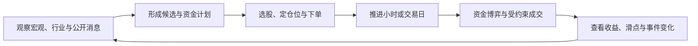
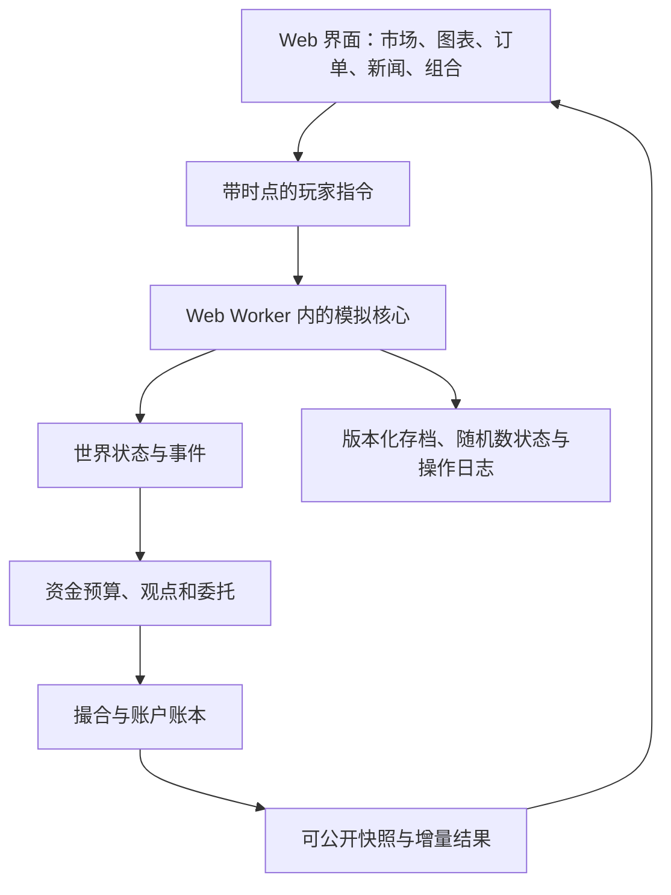

# 虚构金融市场模拟游戏：可行性、玩法与复杂度评估

> 0.2 设计同步：已确定短线/波段/长期资金的不同观察与调仓规则，预热改为 250 日；玩家每 250 日结算赛季，可保持完整世界继续经营，发布前验收连续 1,000 玩家日。技术形态用于分析与验证，不强制价格走波浪。具体以[主设计](../design/gameplay-market-model.md)为准；本文工期仍是早期估算，新增验证细项尚未重新核定。

> 2026-10-01 范围更新：首版已调整为每市场 100 股、两市共 200 股；每市场 6 个行业、世界共享 8 个概念，每股 0–2 个概念标签。当前模型选择为“有限预算异质资金群体＋每子步统一价批量竞价”；新闻先公开，玩家与 NPC 依据同一公开信息撤改委托，然后本批统一清算，事件暂停发生在清算前。具体撮合、新闻时序和参数以[玩法驱动市场模型设计](../design/gameplay-market-model.md)为准；本文保留可行性研究背景，不替代详细设计。

研究日期：2026-10-01。状态：立项研究与建议方案，尚未实现模拟器，也未进行性能实测或玩家测试。

已确认方向：Web 打开即玩；首版参考 A 股、美股的制度与市场特征，但世界、企业、人物、新闻和行情均为虚构；每个市场 100 只股票；以策略经营为主，同时包含短线交易和资金博弈。首版暂不提供 ETF，债券、期货作为后续方向。

本文中的参数、玩法、工期与验收门槛是设计建议，不是已经验证的结果。现实规则与软件能力的事实依据在相应位置链接。开发人数、商业化方式和手机端优先级尚未确定，按单机、桌面浏览器优先进行估算。

## 1. 立项结论

**可行，建议先做一个小规模验证版本。产品定位是“经营资金的金融策略游戏”，以日级配置和小时级战术共同构成玩法。**

推荐方案：

- 两个虚构市场各 100 只股票，以不同交易制度、行业权重和资金偏好形成差异。
- 日 K 为默认研究视图，小时 K 为最小玩家可见周期；玩家可选择每小时暂停，或按日/按事件推进。
- 内部每个交易日先采用 16 个有顺序的模拟步，聚合出 4 根小时 K 和 1 根日 K。这里的“小时”是虚构交易时段，两个市场使用统一时钟。
- 行情由宏观环境、行业、公司、事件、市场预期和不同风格资金共同形成；成交必须受现金、股份、报价和交易制度约束。
- 采用 TypeScript、常规 Web 界面、Canvas 图表、Web Worker 和本地存档。完整游戏引擎不是首版的必要依赖。
- 内部验证版本缩小到 40 只股票（两市各 20 只）；公开首版仍以两个市场、总计约 200 只为目标。

技术可行性的把握较高；市场模型能否持续产生有趣、可理解、难以机械套利的局面，仍需要原型验证。这部分也是项目最大的工作量和不确定性。

## 2. 逐项回应原始设想

| 设想或问题 | 建议 | 原因与取舍 |
|---|---|---|
| 开局自定义本金 | 沙盒模式允许范围内调整；挑战模式固定本金和规则 | 本金改变的是玩法和资金容量，单纯比较最终财富会失去公平性 |
| 每个市场 100 股 | 保留目标；按行业与公司原型约束生成 | 数量本身可控，真正成本是差异、解释和调参 |
| 小时 K 还是日 K | 同时提供；小时 K 最小可见，日 K 默认 | 短线需要观察盘中变化，经营不应被迫每小时点按钮 |
| 日 K 会不会无法做对手盘 | 不会；展示周期与成交计算分开 | 不能只凭一天的最高、最低价倒推成交先后 |
| T+1、T+0 | 保留为两个市场的重要制度差异 | 形成隔夜预判和日内纠错两种策略空间 |
| 大资金影响行情 | 通过有限报价、库存和其他资金反应实现 | 玩家越大，成交成本和退出难度越重要 |
| 事件消息驱动 | 先生成世界状态与事件，再产生消息和资金反应 | 防止新闻只是给已画好的涨跌找理由 |
| 破产、富可敌国 | 设置多种结局，分别处理净值、流动性和起始条件 | 账面浮盈不能直接充当可兑现财富，无杠杆账户也不应凭空欠债 |

## 3. 玩法：配置与交易相互支持

### 3.1 核心循环

一个典型决策是：某类产业受政策支持，但龙头已经过热；玩家可以买入尚未充分反映变化的公司，也可以用小部分仓位交易强势股，或等待流动性改善。收益由选股、时机、仓位和成交成本共同决定。

策略经营层负责“投哪里、投多少、多久退出”；小时级战术负责“现在追还是等、一次买完还是分批、热点拥挤时怎么离场”。两者共享现金、持仓和风险，不能成为两套互不相干的小游戏。

### 3.2 首版短线玩法必须成立

| 玩法 | 可观察依据 | 玩家取舍 | 可能失败的原因 |
|---|---|---|---|
| 题材轮动 | 相关股票强弱、成交活跃度、消息阶段 | 做领先者还是做后续扩散 | 题材兑现后退潮，相关性失效 |
| 趋势与回撤 | 已完成的小时 K、量价、相对板块强弱 | 追价或等待回撤 | 假突破、风险偏好反转、退出拥挤 |
| 日内兑现 | 即日可卖市场的持仓、近期清算价与成交容量 | 快速止盈止损或继续持有 | 费用、滑点、反复交易消耗本金 |
| 隔夜预判 | 次日事件日历、已有预期、持仓可卖时间 | 锁定机会还是保留现金 | 隔夜跳空，买入当日无法撤退 |
| 大单执行 | 预计参与率、可成交量、成本区间 | 快速完成或分时执行 | 暴露需求、推高买价、卖出承接不足 |

这里的“资金博弈”首先指不同资金期限、预期、库存和风险承受能力之间的冲突。首版不需要加入秒级抢单、真实席位名称或逐笔盘口微结构。

一套价格路径不能保证所有风格都赚钱。希望验证的是：玩家在不同市场状态下，确实有理由调整风格；“永远满仓追热点”与“永远持有最大盘股”都不应稳定支配其他策略。

### 3.3 财富增长需要改变问题

- **小资金阶段**：重点是发现机会、控制集中度，少量交易对价格影响有限。
- **中等资金阶段**：开始遇到小盘股容量限制，需要分批、分散、保留备用现金。
- **大资金阶段**：建仓本身影响价格，其他资金可能跟随或撤退；账面盈利更容易，退出更困难。
- **后期**：需要跨行业、跨市场调配，比较收益与资金容量。是否增加机构经营、募资、控制权，是独立后续版本决策。

阶段尽量由“订单占市场可成交量的比例”自然产生，不只靠财富等级给玩家附加惩罚。初期不要通过频繁强制消费或随财富同步变强的随机灾难抵消玩家进步。

### 3.4 200 只股票不等于玩家要看 200 张图

提供市场概览、行业热力图、概念关联、条件筛选、持仓和自选列表。推荐让玩家日常重点关注 10–20 个标的，组合持仓数量由策略决定，不强制上限。

信息筛选只能使用已公开信息，不能根据系统已知的“明天将暴涨”暗中推送股票。首版信息面板宜精简为：估值/经营趋势、规模与流动性、近期量价、题材与事件、组合风险。

## 4. 时间、K 线和两个市场

### 4.1 分开三种时间粒度

| 层级 | 首版建议 | 用途 |
|---|---|---|
| 玩家决策 | 小时、交易日，或重要事件时暂停 | 支持短线与经营两种节奏 |
| 图表显示 | 小时 K、日 K；周 K 可聚合 | 分析趋势与执行结果 |
| 内部模拟 | 每日 16 步，4 步组成一个游戏小时 | 排列事件、委托、资金决策与成交 |

16 步是原型起点，不是研究证明的最佳参数。若四次内部更新仍让小时 K 和成交显得粗糙，可增至 32 或 48 步；是否增加应由价格质量与性能测量决定。

一根日 K 不包含“先到最高价还是先到最低价”。因此，不能看到当天最低价低于买单价就直接判成交，也不能允许玩家看完日 K 后回到日内成交。小时 K 也不能按先定收盘价、再随机补上下影线的方式生成可交易路径。

### 4.2 可执行的时间推进语义

玩家在时点 t 看见的是截至 t 的数据。新委托只能参与尚未清算的下一批次；若事件已公开而当前批尚未清算，可按该事件决策窗口撤改委托。不能按已经过去的收盘价无条件成交。

每个内部步按固定顺序处理：

1. 推进到该时点，执行已到期的持仓解锁与其他状态变更。
2. 发布此时应公开的事件，更新世界状态和共同可见信息；如触发事件暂停，在本批清算前等待玩家决定。
3. 玩家与各资金群体依据同一公开信息撤改委托，NPC 不读取玩家本批委托再临时改变观点；冻结全账户预算与可售库存。
4. 汇总本批订单，以统一价格清算并处理有限容量下的部分成交；同步记账、更新持仓，价格只从已发生的成交产生。
5. 记录批次结果，聚合 K 线；已完成的批次不能回退修改，小时结束或成交条件可触发后续暂停。

盘中事件触发暂停时，本批尚未清算，玩家与 NPC 都有按同一公开消息调整委托的机会；恢复推进后共同参与本批清算。旧价格只是上一批的历史，不承诺成交，新消息下的价格与数量由新订单供需决定。已提前披露的日历事件允许事前布局，但不泄露结果。

**快进只减少停顿和渲染，不跳过同一套模拟步骤。** 无新操作时，逐小时推进与一次推进一天必须得到一致结果。

### 4.3 现实参考与虚构规则明确分开

首版建议两个交易所共用每日四个虚构交易小时、同一交易日历和一种结算单位，暂时省去汇率、夏令时和真实跨时区夜盘。跨市场传导通过宏观与资金配置实现，而非依赖现实交易时间表。

| 项目 | 市场甲：次日可卖型 | 市场乙：即日可卖型 |
|---|---|---|
| 当日新买股份 | 下一交易日开盘解锁 | 下一可执行步可以卖出 |
| 旧持仓 | 可交易时段内可卖 | 可交易时段内可卖 |
| 买卖资金 | 首版成交后统一进入可用余额，委托资金另行冻结 | 同左；明确为游戏简化 |
| 波动制度 | 统一日涨跌幅边界，可先测试 ±10% | 无固定日涨跌幅边界，设置极端波动暂停机制 |
| 资金/公司分布 | 较高题材交易权重，行业与规模分布多样 | 较高长期配置权重，成长与成熟公司并存 |
| 主要策略差异 | 买入前考虑隔夜风险、有限成交分配与次日退出 | 更灵活纠错与兑现，同时承担频繁交易成本 |

这些是玩法参数，不是对现实市场每个板块、账户和证券品种的完整复刻，也不是“甲市场只炒题材、乙市场只看价值”的固定脚本。

现实美股的“当日可卖”和证券“次日结算”是不同维度，不能把 T+0 当作所有资金都可无限循环使用。[SEC 投资者现金账户说明](https://www.investor.gov/introduction-investing/general-resources/news-alerts/alerts-bulletins/investor-bulletins/updated-9)。其他现实规则与来源详见 [市场模型研究](./market-model-feasibility.md)。本项目为突出制度玩法，建议首版主动简化现金结算，把股份可卖时间单独建模。

极端情况下，涨停买单可能没有卖方，跌停卖单可能没有买方；到达限价并不保证成交。暂停、休市和解锁必须按市场交易日处理。

## 5. 行情如何既像市场，又拥有独立世界

### 5.1 借鉴统计特征与因果关系

现实资产收益研究讨论了尾部风险、波动聚集和股票之间的依赖关系。这支持把“平静与动荡交替、相关股票联动、偶发剧烈变化”作为模拟质量的检查维度；它不证明某个简化模型足以还原真实市场。[Cont，Stylized Properties of Asset Returns](https://onlinelibrary.wiley.com/doi/abs/10.1002/9780470061602.eqf19027)

建议使用五层状态：

| 状态层 | 内容 | 更新节奏 |
|---|---|---|
| 全球/宏观 | 需求、融资成本、通胀压力、整体风险偏好 | 主要按日，事件可即时改变 |
| 市场 | 本地资金活跃度、制度、风险预算 | 日与盘中 |
| 行业/概念 | 景气、成本、政策支持、关注度 | 日与事件 |
| 公司 | 盈利能力、负债压力、竞争力、经营变化 | 慢变量为主，公告时变化 |
| 交易资金 | 对未来的分歧、动量、库存、现金约束与随机需求 | 每个内部步 |

不同公司对各因素的敏感度不同。宏观变化同时影响两个市场，但产业权重、估值与资金结构会造成反应差异。

不要先生成一条不可改变的价格曲线，再让玩家假装参与。建议先计算经营状态和参与者的估值/需求，再通过报价与交易形成价格。玩家行为由此能改变之后的资金库存与行情。

### 5.2 噪声要带来分歧，而不是抹掉策略

建议噪声包括公司经营扰动、资金临时赎回/再配置、观点误差和传闻传播。波动强度随风险状态变化，不必每天相同。

纯随机漫步容易让研究毫无意义；确定的“利好出现后必涨三天”又会变成背公式。可玩的区间是：信号有价值，但受预期、估值、流动性和其他参与者影响，并有失败概率。

市场状态可以有扩张、过热、收缩、修复等阶段，但转换应依赖状态和有持续性的随机过程，避免固定每隔若干天换牛熊。状态标签是否完全向玩家公开，也要测试；首版更适合展示有滞后的经济指标与“偏热/偏冷”的解释。

### 5.3 股票采用约束生成

范围缩减后采用每市场 100 股、6 个行业，世界共享 8 个可跨行业概念；每股最多 2 个概念，也允许无概念，但标签必须由业务暴露支持。按统一的六行业顺序，甲市场配额为 24/20/18/16/12/10，乙市场为 10/16/12/18/20/24，各合计 100。每市场初始市值分布为大盘 20、中盘 35、小盘 45，再从成熟现金流、周期制造、成长创新、脆弱高负债等公司原型生成。该配额是开局生成约束，后续市值随成交价格变化。

重要属性包括：行业、概念暴露、经营质量、增长、负债、总股数、流通股数、股东结构、流动性和信息可信度。**市值应由价格乘股数得出，不能同时作为独立随机变量漂移。** 大小盘分类可随市值变化，但市值档变化不能自动增加股份、现金或报价深度；实际容量仍由资金预算、可售库存与委托决定。

公司经营、流通股份与初始报价之间需要合理约束。200 家可以由几十个原型和参数组合形成，不必手写 200 套剧情；名称、业务描述、事件文本仍要审核，以免大量公司体验雷同。0.2 已确定开局前用同一模型预热 250 个虚构交易日，形成历史图表、长期指标与既有行情状态；预热只生成过去，不计入玩家赛季，不能提前给玩家提供未来路径，且需纳入启动性能预算。

### 5.4 虚构映射规则

- 地理、交易所、公司、货币、人物、媒体和年代采用原创世界设定，具体命名先用占位名。
- 可借鉴“供应收缩→成本上升→利润受压”等一般因果结构，不复制某次现实新闻及真实行情路径。
- 不建立“虚构公司 A 永远对应现实公司 B”的一对一映射，避免玩家用现实记忆直接解题。
- 一局开局固定世界种子、公司集合与规则。刷新页面、切换股票、切换周期不能重抽世界。
- 研究文档可引用现实制度；游戏内经济信息则保持虚构。开源软件的许可证与必要署名放在独立说明中处理。

## 6. 资金与对手盘：推荐有限资金群体模型

### 6.1 候选路线与当前选择

| 路线 | 能力 | 风险 | 结论 |
|---|---|---|---|
| 因子价格公式＋简单滑点 | 快速产生曲线、便于调参 | 容易变成无限对手盘；玩家影响不可信 | 可做早期视觉草图，不能独自满足本项目目标 |
| 有限资金群体＋简化多档连续撮合 | 有风格分歧、现金库存、流动性和价格冲击 | 同刻下单顺序与事件暂停容易引入先后优势 | 前轮推荐的历史候选，本轮不采用 |
| 有限资金群体＋每子步统一价批量竞价 | 同信息决策、有限容量、价格冲击与资金守恒 | 需明确清算价、部分成交分配和信息边界 | **当前首版选择**，详见详细设计 |
| 海量独立交易者＋完整逐笔订单簿 | 可研究复杂微观结构 | 行为调试、校准、性能与解释成本高 | 首版不采用 |

ABIDES 展示了离散事件、多代理、交易所交互的研究路径，但其研究级消息、延迟和大量代理并不是本游戏的必要配置；参考其边界思想即可。[ABIDES 原始论文](https://arxiv.org/abs/1904.12066)

### 6.2 资金群体怎样工作

原研究提出价值配置、趋势、事件、流动性供给、噪声/被动调仓等资金动机；当前类型、数量和权重以详细设计为准。每类可以分成若干持久资金池，持有真实的现金与股票库存，不需要每个虚拟投资者都有名字。

每一步先根据风格形成各股目标，再受整个资金池总预算约束，分配可提交的订单。不能对每只股票都重复使用同一份“可用资金”。对双市场共用资金池，更要在两个市场提交委托前统一冻结预算。

当前采用每子步统一价批量竞价：先公开消息并完成玩家与 NPC 的决策，再以同一批订单的供需共同形成清算价。报价可以有不同限价，但本批实际成交使用一个价格，不按玩家与 NPC 的提交毫秒先后给优势。订单有效期先限制为当日有效；部分成交后的有效余单进入后续批次或撤销。受保护的即时委托只有本批有效，容量不足时部分成交并撤销余量，不能自动补造对手盘。同一账户不得自成交。清算价选择、分配和舍入以详细设计为准。

每次成交同步记录买卖双方现金和股份，收费进入可审计的费用账户。无杠杆版本中，任何参与者都不能卖出不存在的股份或用负现金买入。派息、外部资金进入、公司退出若被加入，也要记录来源与去向，不用无解释的“自动回血”维持流动性。多年局若需要经济规模增长，可通过有来源记录的外部储蓄/资金配置事件扩充市场预算；不能一边宣称全系统现金固定，一边让所有账户长期免费增加资金。

无成交时不应凭估值变化伪造交易价格和成交量；可展示参考报价，K 线使用明确的无成交规则。指数由成分实际价格和权重计算，不作为反过来强迫所有股票跟随的独立价格脚本。

### 6.3 大资金的影响怎样产生

1. 大买单改变本批需求与供给的交点，可能抬高统一清算价；限价与卖方库存不足时仍只能部分成交。
2. 卖方持仓减少、买方现金减少，后续供需真的改变。
3. 其他资金根据已发生的成交和价格变化反应；趋势资金可能跟随，价值资金可能反向交易。
4. 卖出退出时再次承担流动性成本，不能将全部持仓按最后一笔小额高价兑现。

订单影响应主要取决于其占可成交量的比例、流通盘和市场状态，而非只看绝对金额。研究中的平方根价格冲击关系可以作为校准时的参考形状，但不是适用于任何订单规模的硬规则，更不能未经验证直接照搬。[Tóth 等，Anomalous Price Impact and the Critical Nature of Liquidity](https://journals.aps.org/prx/abstract/10.1103/PhysRevX.1.021006)

**避免重复计价**：如果本批供需清算已经体现订单冲击，就不能再无条件叠加一个“大单涨价百分比”。需要额外持久影响时，应通过下一步资金观点和库存改变体现。

历史候选 B 的连续撮合示例曾按 10.01、10.02、10.05 各 1,000 股逐档成交，得到均价约 10.0267；这一算法不再作为当前设计。当前 C 方案即使沿用这些报价，也必须汇总全批买卖需求后选定一个清算价，再分配数量，不能把该旧均价作为期望结果。无论方案如何，买到的股份都不能保证以最后价格全额卖出。

### 6.4 资金信息怎样展示

建议展示上一批的买卖申报失衡、实际换手、成交与未成交比例、延迟容量估计、估计拥挤程度，以及玩家自己的成交报告。统一价竞价没有天然的逐笔主动买卖方向；当前批 NPC 隐藏委托不得在玩家决定前直接透出。避免把 NPC 的精确账户、隐藏估值和未来订单直接公开为“主力资金真相”。

每笔买入必有对应卖出；所谓资金变化必须说明统计的是某类账户已结算的现金或持仓变化；申报失衡应单独命名，不冒充主动买卖净流入。不能把成交额当成凭空进入市场的新现金。

市场的指数层面影响优先通过成分股权重、跨股资金再配置和风险偏好反馈产生。玩家达到足以改变整个虚构国家经济的规模时，现货模型的解释能力会触顶，应以结局或更高级后续系统承接。

## 7. 事件、新闻与预期差

事件至少包含：发生条件、真实影响、公开时点、影响对象、持续时间、市场原有预期、可靠程度和后续分支。事实变化、公开新闻、资金反应是三个不同层次。

建议首版覆盖宏观、行业、公司、流动性四类事件。消息类型区分公告、数据、媒体解读和传闻。并非每条消息都要玩家操作，也不必每次波动都有一条完美解释。

示例事件链：

1. 虚构“储能设施”行业订单增加，部分公司公告改善。
2. 资金逐渐形成乐观预期，相关股票活跃，低质量公司也可能被带动。
3. 产能扩张提高成本，业绩兑现出现分化。
4. 若实际结果弱于已形成的预期，业绩增长的公司也可能下跌。

玩家可在早期布局，中期参与趋势，后期选择退出或换到真正兑现的公司；各阶段都有不同风险。事件从状态与条件中抽样，而非每次同标题必有同收益。

范围缩减后的当前设计采用 24 个事件模板、6 条可分支事件链，通过公司/行业和参数扩展。事件“导演”只控制重复率、节奏与阅读负担，不应偷偷按玩家持仓定向发坏消息来强制维持难度。

事件文本优先使用人工审核的模板和参数填充。无需在运行时调用大模型决定市场：这会增加延迟、费用、不可重复性和因果一致性问题。生成式工具可以用于开发阶段辅助写候选文本。

## 8. 开局、时长、结局和重玩

### 8.1 本金与模式

首版可以采用一个交易系统、两组开局规则：

- **经营挑战**：固定本金与首季 250 日长度，按不同种子重玩；首季成绩冻结后可以在同一世界续季，续季不与首次开局挑战混排。
- **自由沙盒**：本金滑块和少量难度选项，允许长期继续；成绩注明起始条件，不与挑战混排。

本金的初始测试范围可设为 10 万至 1,000 万虚构货币，默认 100 万。最终范围取决于公司价格、最小买入单位与市场容量，不能先把数字写死。最大起始本金应明显低于首个高阶财富结局门槛。

固定 100 万本金时获得 2 倍收益，与起始 1,000 万再赚 10%，分别体现不同结果；仅用最终净值排名不公平，单看收益率也忽略资金容量。首版可先展示净值倍数、最大回撤、期间基准和流动性成本，不急于压成一个分数。

### 8.2 一局的节奏需要实测

当前采用 60 个交易日体验原型、250 个交易日标准赛季；每季结算成绩而不强制结束生涯。公开版前验证连续 1,000 玩家日，预热另算。目标是经营玩家能够跳过平静期，短线玩家在少数活跃交易日多做判断。现实游玩时长通过暂停次数、决策次数和试玩测量，不在测试前承诺。

小本金、短局、接近现实的回报数量级与“富可敌国”不能轻易同时满足。例如从 10 万到 1 万亿是 1,000 万倍，即使假设每年翻倍，也需约 23.3 年；这只是复利算术，不是收益预测。高阶财富目标更适合长期篇章或重新校准后的虚构经济规模，不宜要求玩家在一个短赛季内完成。

若每天有四次强制暂停，250 个交易日就是 1,000 次停顿，容易变成机械操作。因此默认按日或事件暂停，玩家主动开启“逐小时”模式，并可设置持仓风险、消息和订单异常提醒。

### 8.3 结局要与金融规则一致

| 结局 | 触发建议 | 关键限制 |
|---|---|---|
| 资本耗尽 | 可变现资产低于最低继续经营门槛，持续若干交易日并由玩家确认结束 | 不把暂时 T+1 锁定或现金不足当破产 |
| 安稳退休 | 达到财富与回撤目标后主动结束 | 不需要所有玩家都无限追求最高财富 |
| 资本巨头 | 较高财富、经历周期与足够可兑现能力 | 不只看某一笔交易抬高的估值 |
| 富可敌国 | 可持续、可兑现财富达到世界设定中的高门槛 | 必须与当前模拟规模匹配；可能作为后续高级结局 |
| 赛季结算 | 每 250 玩家日按收益、风险和风格记录成绩 | 可继续同一生涯或退休，原成绩冻结，市场与未到期计划不重置 |

首版不含借贷、融资和做空时，一般现货亏损不应让现金变成负数。若要有真正债务违约或保证金破产，就要同时承担杠杆、强平、跳空负债和风控系统成本，建议后置。

胜利判定可要求资产门槛持续若干日，并有合理比例的已兑现现金/可执行变现能力；估算变现值应说明折价假设。不要允许“用最后一点现金拉高重仓股，然后立即按收盘价通关”。

## 9. Web 技术与引擎选择

建议架构：

模拟核心不依赖 UI 或渲染帧率，可在浏览器后台线程运行，也可在命令行中批量验证。金融金额、股份和价格步长使用明确的整数单位或固定精度运算，防止浮点误差累积；长期金额范围也要校验。

| 路线 | 适用性判断 | 建议 |
|---|---|---|
| TypeScript + React/Vue + Canvas 图表 | 适合大量表格、筛选、图表和文本交互 | **首选**，团队熟悉哪种 UI 框架就用哪种 |
| Phaser / PixiJS | 适合加入 2D 场景、人物和更丰富动效 | 需要此类表现时局部使用，仍保留独立模拟核心 |
| Godot Web | 团队熟悉 Godot、希望跨平台且有较强场景表现 | 可行，但需验证 Web 导出、加载和 HTML 界面整合 |
| Unity Web | 团队已有 Unity 积累或后续重视复杂场景 | 可行；当前需求下额外工程成本缺少回报 |

主观选择依据是当前产品以金融信息交互为主，并非断言游戏引擎做不到。软件能力、移动端支持和导出约束详见 [引擎专项研究](./engine-feasibility.md)，不要沿用“所有 Web 引擎都必须多线程”或“Unity Web 完全不支持手机”等过时概括。

图表建议先用 KLineChart 做小时/日 K 与指标的适配验证，ECharts 可用于资产、行业与其他统计图；也可先统一用 ECharts 降低集成数量。Lightweight Charts 需特别核对可见署名要求与虚构世界的呈现要求。具体版本与许可证以选定版本为准。[KLineChart 官方仓库](https://github.com/klinecharts/KLineChart)、[Apache ECharts](https://echarts.apache.org/)、[Lightweight Charts 官方仓库](https://github.com/tradingview/lightweight-charts)

### 9.1 首版建议纯客户端

静态资源托管，无需账号就能开始；本地自动保存并提供导入/导出。浏览器关闭后，游戏时间停止。重新打开从存档继续，而非按现实离线时间结算市场。

云存档、跨设备、排行榜和多人市场都可以以后添加。尤其是可信排行榜需要服务器验证或权威计算，不能因为存档带签名就认为客户端不可修改。

存档需保留模拟版本、完整世界状态、随机数状态、事件状态和交易日位置。完整状态包括玩家及所有 NPC 资金池的现金、持仓、冻结资源、委托，以及持续的观点与风险状态；不能只保存玩家账户。相同版本、同一初始状态与相同操作应可复现；跨版本采用明确迁移或保持旧局兼容，不承诺不同实现的浮点计算天然逐位一致。

### 9.2 规模估算，不是性能承诺

200 股 × 每日 16 步 × 每年 250 日 = 每年约 **80 万次股票步更新**。当前设计共 26 个 NPC 账户，每只股票可由 12 个本地与 2 个跨市场账户参与，对应每年约 **1,120 万次账户—股票评估**，还未计撮合、排序、事件、存档与渲染。五年约 5,600 万次此类评估。账户数不能与资金风格类别数混算。

这个量级值得用普通 Web 技术验证，不能仅凭算术保证低端设备流畅。首个原型就应测量快进、启动预热与长期存档；避免每个内部步向界面发送 200 股的完整历史。

若仅按时间戳和 OHLCV 六个 64 位数估计，每根 K 线 48 字节：200 股、每年 250 日、五年日线约 12 MB；全部保留五年、每天四根小时线另需约 48 MB。这里不含对象、索引、存档副本和日志开销。0.2 保留完整日线、至少最近 120 日小时线，归档时保留运行中指标及形态参考；250 日预热另增加一年的初始历史和模拟成本。

建议性能验收目标为：声明测试设备后，平静的一日推进通常低于 200 ms，连续快进可取消且不长期冻结界面，首次进入控制在少量 MB 级资源与数秒量级等待。所有目标须由原型测量修订；Worker 只能帮助保持界面响应，并不自动减少总计算量。

## 10. 首版边界与验证闸门

### 10.1 首版必须有

双市场约 200 股；受约束的行业/概念/市值分布；自定义本金；日/小时两种操作节奏；T+1/T+0 持仓规则；市价保护委托与限价委托、撤单、部分成交；有限资金与库存；事件和预期；基础图表、选股、自选与组合；可解释的成交回执；暂停/快进；本地存档；结算与至少三类结局。

短线、流动性和大资金影响属于首版必要内容，不能用后期再补一句话替代。小时级策略要能够在实际模拟中改变交易结果。

### 10.2 首版后置

债券、期货、期权、ETF、做空、融资、衍生品保证金、真实汇率和跨时区日历、完整三张财报、复杂公司治理、完整逐笔盘口、海量独立交易者、在线多人、真实行情接入、运行时生成式新闻。

拆分、派息、退市和增发可分阶段增加：即使只是其中一项，也需要同步账本、价格和历史口径，不能只加一个新闻标题。验证版先固定股票池，可通过经营恶化体现风险；首版是否纳入简化派息与退出流程，应在原型后根据经营玩法需要决定，并单独核算。

### 10.3 三道验证闸门

**闸门一：市场成立。** 先用 40 股（两市各 20 股）、两个规则配置、少量事件跑出一段完整市场。核验账户与股份守恒、T+1、部分成交、涨跌幅边界、没有未来信息，以及大单确实增加自身成本。观察是否长期失去对手盘或价格单边漂走。

**闸门二：玩法成立。** 在相同信息条件下，对比持币、分散持有、趋势、事件、随机、反复交易等基准策略。观察跨种子结果及资金容量，不要求复杂策略每局获胜，但不能存在一种无须判断的操作稳定统治。邀请少量目标玩家验证：能否解释为何成交失败、为何行情与新闻不完全一致，以及何时愿意切换到小时操作。

**闸门三：规模成立。** 扩到 200 股，做多年快进和浏览器测试，检查性能、长期存档、事件重复和信息负担。通过后再补内容与视觉，不先堆满公司数量。

建议初步批量检查 100 个种子，核心漏洞另用定向场景；这是发现明显问题的起点，不是统计充分性的证明。

必须覆盖的高价值检查：

- 同一操作下，小时推进与按日快进结果相同；打开图表不影响随机数序列。
- 买入当日新股份无法在次日可卖市场出售；旧股份仍可卖，撤单正确释放冻结资源。
- 在无新闻、无外生漂移、无其他资金反馈的隔离环境里，自买自卖和拆单不能凭模型错误制造净财富。
- 在完整市场中扫描“反复拉升—卖出”“尾盘小单抬估值”“刷成交量触发跟风”等策略是否构成可无限重复的漏洞。
- 玩家不能因新闻暂停获得过期报价；触及限价或 K 线低点不等于一定成交。
- 双市场共同消耗同一现金时不能超支；快进跨日正确解锁，事件不会重播。
- 无成交、停牌、跌停无人买、大额清仓与断点恢复都有明确结果。

## 11. 复杂度和投入评估

### 11.1 难度分布

| 系统 | 难度 | 主要风险 |
|---|---|---|
| Web 信息界面与图表 | 中 | 信息量和交互层次，不是单纯页面数量 |
| 股票世界生成 | 中 | 200 股缺乏差异，参数相互矛盾 |
| 撮合、账本与制度 | 高 | 双重花费、库存错误、跨日与订单状态 |
| 行情、资金与事件联动 | 很高 | 随机无意义、机械套利、模型失稳 |
| 长短线平衡 | 很高 | 短线碾压持有，或小时操作没有收益价值 |
| 结局、成长与内容 | 中高 | 后期失去挑战、事件重复、结算可被操纵 |
| 本地存档与性能 | 中 | 长局数据、版本兼容、恢复一致性 |

综合判断：这是一个**中高复杂度的系统型独立游戏**。界面可能看起来轻量，内部的金融一致性与可玩性工作明显多于普通数据看板。

### 11.2 估算口径

1 人周指熟悉技术的开发者约五个工作日的有效投入。估算包含设计、实现、验证和必要返工；不假设 AI 能以固定倍数缩短时间。工作区当前没有可复用代码，按从零开始估算。

股池减半主要减少内容编排、浏览负担、每步计算和历史存储，账户守恒、双市场规则、事件因果、资金行为与平衡测试仍需完整实现，不能把工期减半。以下保留原估算作为保守预算，待 40 股原型后重新校准。

下面是待原型校准的规划区间，不是工期报价。预算人数尚未确定，采用分档估算。阶段之间按**累计投入**阅读，不能把各行再次相加。

| 阶段 | 范围 | 累计基础投入 | 含约 30% 风险余量 |
|---|---|---|---|
| 验证原型 | 40 股（两市各 20 股）、双制度、少量事件、小时/日决策、资金与成交验证 | 4–6 人周 | 以固定投入验证，未通过则调整范围 |
| 最小公开试玩版 | 约 200 股、完整基本循环、事件内容、本地存档、基础结局、桌面浏览器交付 | 24–36 人周 | 约 31–47 人周 |
| 打磨首版 | 更丰富事件、教学、平衡、反馈、兼容与发布准备 | 40–60 人周 | 约 52–78 人周 |

公开试玩版的工作包基线：世界、循环与可玩原型 4–6 人周；账户、订单、双市场制度与存档 4–6；图表、筛选、消息与双时间模式界面 5–7；200 股、事件、资金行为与结局闭环 5–8；经济核验、长短线试玩、兼容和部署 6–9。合计 24–36 人周，再增加约 30% 风险余量。原型已经计入累计总量，不额外加一次。边界项归属应在立项后固定，避免重复计数。

以全职、已有相关技术经验估计自然时间：

- **个人＋AI 辅助**：原型约 1–1.5 个月；公开试玩版约 8–12 个月；打磨首版约 13–20 个月。这是包含上述余量及少量日程缓冲的预算带。
- **2–3 人小团队**：原型约 3–5 周；公开试玩版约 4–6 个月；打磨首版约 7–10 个月。市场模型与玩法调参存在串行关键路径，不能简单除以人数。
- **业余开发**：应按每周实际有效投入换算，并额外考虑切换成本；不能把人周直接当日历周。

这是中等置信度以下的早期估计，原型后应重新估算。首版若坚持真实跨时区、真实账户结算、完整盘口或完整手机适配，区间会上移；如果只是可交互的概念演示，则可以显著短于公开试玩版，但无法据此证明游戏完整可行。

资金预算可按“总人周 ÷ 4.3 × 团队每人月综合成本”估算，再加入外包美术、内容和发布支出。没有人员成本信息时，不给出貌似精确的货币报价。纯客户端首版可以避免持续行情采购、撮合服务器和运行时模型调用，但仍有域名、静态托管与分发维护成本。

## 12. 债券与期货的扩展准备

首版预留资产标识、市场日历、报价单位、持仓、现金流、订单和结算事件边界即可，不必现在构造一个包罗所有金融产品的框架。

| 扩展 | 新增核心机制 | 与股票版的关系 |
|---|---|---|
| 债券 | 面值、票息、到期、收益率与价格关系、利率/信用风险、应计利息 | 可复用宏观利率和账本，但不能只换股票名字 |
| 期货 | 合约乘数、到期、保证金、逐日盯市、多空、强平、移仓与标的关系 | 需要新的风险与结算系统，复杂度明显增加 |

更合适的路线是先让股票版的利率、行业供需和账户账本可靠，再评估债券或一个有限的期货品种集。仅作为粗略规划储备，简化债券扩展可能需要额外 4–8 人周，有限品种期货扩展可能需要 8–16 人周；这些不包含在首版估算内，需另行定义范围，不能当承诺。

## 13. 建议的下一步

下一阶段应是一个 **4–6 人周的玩法验证原型**，优先回答三件事：

1. 小资金做短线、大资金做配置/分批执行，是否出现不同且有趣的决策？
2. 玩家能否根据公开信息理解局面，同时又不能靠单一规则持续机械获利？
3. 同一个世界在小时操作和按日快进之间切换，是否保持金融规则、因果顺序与操作体验一致？

公开首版公司数量已固定为每市场 100 股；原型通过后再校准事件规模和内容计划。若失败，优先调整资金与事件模型，而不是继续增加股票数量或更换渲染引擎。

专项材料：[引擎与 Web 可行性](./engine-feasibility.md) · [市场规则与模型](./market-model-feasibility.md) · [玩法与范围评估](./gameplay-and-scope.md)。当前详细设计见[玩法驱动市场模型设计](../design/gameplay-market-model.md)。研究内原型统一为 40 股（两市各 20）；对局时长仍需试玩验证。引擎专项的 1–2 周是完整验证原型中的技术试验，不是另一个公开版交付承诺。
