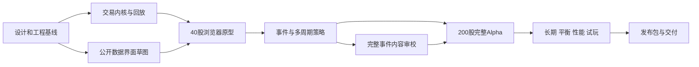

# 总实施计划

版本：1.0；状态：规划。配合[阶段总览](README.md)使用。工程初始化已建立`apps/web/`、`packages/sim-core/`占位和基础npm命令，详见[项目README](../../README.md)。本文的市场API、CLI、阶段验证及发布包仍是计划产物；工程骨架不代表模型实现或P0验收通过。

## 1. 实施顺序与并行安排

主依赖为P0 → P1 → P2 → P3 → P4 → P5 → P6。G0–G4是模型质量闸门，不是同名阶段：P0关闭规则歧义，P1核对交易合同，P2初验经济，P3初验玩法，P4组装完整产品，P5统一完成闸门证据，P6交付。

核心工程在P1定下Interface后，Web可用同一公开数据合同做交互；fixture只用于界面开发，P2出口必须接真实核心。P3的内容可与已冻结事件schema的实现并行，不能先写会改变隐藏结果的剧情按钮。P4功能未齐前可以跑已有回归和性能诊断，但P5必须针对最终候选构建重新提供受影响范围的证据。

同阶段ticket的精确前置关系在各`tasks.md`；每阶段plan负责整合。跨阶段更改规则必须带版本和影响列表，不让P1旧快照、P3参数和P4存档各用不同定义。已过的独立检查不无理由重复全跑；改动触及账本、随机流、目标、世界生成或数据精度时，重跑对应固定场景及受影响的长期/策略检查。

## 2. 工程起点与默认方案

以研究推荐的TypeScript纯模拟核心、DOM界面、Canvas金融图表、单个Dedicated Worker、IndexedDB和静态部署为实施方案。工程初始化已采用React+Vite、TypeScript和npm workspaces，具体版本以锁文件为准；图表候选KLineChart、测试候选Vitest与Playwright尚未安装，在实际功能需要时验证并引入。初始化不替代P0的图表、Worker、数值和兼容能力试验；只有验证不满足当前需求时才更换并记录理由。无需先引入游戏引擎、后端、WASM或多线程共享内存。

目录及职责（Web已有固定示例数据的UI预览，核心仍为骨架，其余按阶段创建）：

| 计划路径 | 内容与负责人 | 不应放入 |
|---|---|---|
| `packages/sim-core/` | 世界创建、时钟、公开过程、账户、命令、批量清算、指标与序列化的深Module；核心工程 | DOM、浏览器存储、绘图、全局真实时钟或未受控随机数 |
| `apps/web/` | Worker Adapter、公开视图、图表、下单和本地存档体验；Web工程 | 重写价格/费用/解锁规则、读取未来事件作实时提示 |
| `tools/sim-runner/` | 同核心的CLI Adapter、种子实验、回放、诊断和报告；核心/验证 | 用另一套近似价格模型替代生产成交 |
| `tools/design-checks/` | 已有Python设计算术核验；模型/验证 | 冒充实际TypeScript交易内核的测试结果 |
| `tests/scenarios/` | 固定订单、公开信息前缀、跨日/跨季与失败反例；随相应ticket交付 | 只检查函数调用次数的实现镜像 |
| `tests/replays/` | 固定版本golden轨迹和存档样本 | 没有来源/规则版本的二进制快照 |
| `docs/verification/` | 已完成阶段的结论、复现入口及已知问题 | 把本spec中的目标复制成“已通过” |
| `artifacts/verification/<phase>/<run-id>/` | 当次manifest、机器可读结果、摘要、失败最小样本 | 默认全部进Git的海量逐笔日志 |
| `artifacts/releases/<version>/` | 静态包、构建/内容/规则版本、许可与校验清单 | 尚未核验却标稳定的发布物 |

CLI和Worker是同一个核心Interface的两个Adapter；这是实际需要的Seam。核心内部可以分别组织世界、账本和清算，但调用者无需组合一堆私有状态才能安全交易。不为未来债券、期货或插件平台提前扩展公共Interface。

## 3. 核心Interface合同

P0冻结类型、错误与单位，P1实施。名称可以在冻结时微调，能力与时序不能遗漏。

| 操作 | 调用者提供 | 返回与不变量 |
|---|---|---|
| `createWorld` | 规则/内容版本、世界种子、正式或原型配置 | 同输入初始化相同；NPC股份/现金分配可审计；预热与玩家一次性注入有阶段记录 |
| `submitCommand` | 命令ID、公开快照版本、目标批次、订单/撤改/计划 | 明确接受或拒绝及原因；先验资源校验；重复命令不得重复冻结；不能回写已结算批次 |
| `advance` | 停止条件、工作量预算 | 公开准备完成后可在决策窗口暂停；交易清算、资源结转与记账原子提交；返回时点、阶段、暂停原因和可展示增量；相同命令不因UI刷新或快进变价 |
| `readPublicView` | 公司/列表/组合/消息/图表查询 | 只含截至当前公开时点资料及玩家自身账户；显示无成交/未完成/历史不足 |
| `exportSnapshot` / `restoreSnapshot` | 版本化完整状态/待恢复数据 | 可在完整交易批次后或核心确认的公开决策窗口保存；记录当前阶段、随机状态、主体记忆、委托/冻结、世界时钟、赛季及指标；先验证后原子替换，失败保留旧局 |

公开窗口必须在本批NPC下单与清算之前出现。Worker暂停等待玩家期间不得偷偷推进NPC；确认推进时双方基于同版公开信息报价。Worker消息含请求ID和状态版本；晚到消息不得覆盖更晚状态。手动取消快进在最近完整交易批次边界响应，消息触发的暂停则发生在公开准备完成、决策开始之前；二者不能合并成先成交再看消息。快照保留暂停阶段，恢复不能先推进或再次公布/应用同一事件；不能导出清算与记账进行一半的状态。

完整存档包含隐藏世界信息以支持离线恢复，但普通UI/NPC读取合同不能使用其未来字段。本项目不声称本地存档可防玩家自己改档；不为此增加账户体系或加密排行榜。

账务和撮合使用精确整数规则，价格×股数、聚合资产和费用中间量必须防溢出。P0确定BigInt/安全整数的分界、序列化编码及log/exp/随机采样的跨端确定性方案；不以“用了seed”替代黄金回放。浏览器与CLI对比的是世界状态/成交摘要，性能耗时和UI字段不纳入确定性hash。

## 4. 配置、数据与内容

正式世界与40股原型使用同一生成器和规则，只替换受约束的配额与实验配置；40股表由P0单独冻结，不能对100股表任意取前20行。数据校验覆盖行业/市值边际和、每股至多两个合法概念、股份分配精度及无法生成时的明确失败。

规则、内容、存档schema分别标版本。版本与参数hash进入预热缓存和每次实验manifest。改变行为参数后重新初始化/预热对照世界；不把沿用旧钱包的中途切参实验冒充标准同种子开局。发布存档遇未知/不兼容版本先保留原档、说明无法恢复；只有已有对应版本的明确转换器并验证后才允许迁移，不建设泛化迁移框架。

默认新局的打开即玩属于交付合同：P0锁定默认种子选择、初始化与性能协议，P4实现，P5/P6实测。桌面空缓存下，首屏就绪初值p95≤3秒，导航到默认新局可接受交易命令初值p95≤10秒；立即确认默认配置的脚本排除人为等待，下载和初始化时间必须计入。可以用现场计算或随静态包提供完整匹配的预热快照；快照必须保留全部世界状态并与同版本、种子及初始化参数重算一致，不能只有历史K线。预置种子若被采用，清单按预先固定的随机规则生成，不按未来收益挑世界。任意未预置种子现场预热的桌面60秒/移动180秒预算单列，不能代替默认开局目标；具体样本和设备以P0冻结、P5细化的协议为准。

P2的基准配置保留26个钱包、原有钱股、容量和非技术行为；关闭技术/主题项和突发事件的具体参数列入manifest。P3启用完整机制并验证其与基准的差异。P3代表内容是P4的24模板/6链子集；双市场政策事件必须计入该总额，不额外无声扩大内容预算。

市场名称、公司、人物、货币与事件文本全部虚构。现实制度名称与资料只出现在研究/开发说明；游戏内用虚构名称解释本游戏规则。软件许可信息独立于世界观且不得删除。模板结果由世界状态与固定随机键决定，玩家操作仅影响实际委托、资源和可见通知筛选。

## 5. 计划命令与证据

以下区分已提供的工程命令与待实现的阶段命令。实际脚本以根`package.json`为准；没有对应实现的命令不能作为已通过的验证。每个阶段可以实现内部子命令，但交付说明须保持统一入口。

| 计划命令 | 首次提供 | 用途 |
|---|---|---|
| `npm ci`、`npm run typecheck`、`npm run build` | 工程初始化已提供 | 安装锁定依赖、检查与构建占位应用；不代表市场实现，网络安装耗时不计游戏启动 |
| `npm run dev`、`npm run preview` | 工程初始化已提供 | 启动开发页面或预览静态构建；P2再接入真实Web原型 |
| `npm run check`、`npm run check:design` | 工程初始化已提供 | 前者类型检查并构建；后者单独执行已有Python设计算术核验 |
| `npm test` | P1，待实现 | 首批实际交易行为测试落地时引入，不用空测试或Python脚本替代 |
| `npm run verify:pN -- --out <dir>` | 相应P1–P6 | 执行本阶段验证集合，退出码反映硬性失败或必要证据缺失 |
| `npm run sim:replay -- --input <file> --commands <file> --out <dir>` | P1 | 固定场景/快照重放及状态hash对照 |
| `npm run sim:batch -- --manifest <file> --out <dir>` | P2 | 严格按指定种子/版本/时长运行，不挑成功样本 |
| `npm run benchmark -- --profile <file> --out <dir>` | P2有最小测量，P5完整 | 预热、日推进、中断、存档及内存协议 |
| `npm run preview:release -- --dir <release-dir>` | P6 | 使用静态服务器核对待发布包，不依赖开发服务器 |

`verify:pN`不是只运行单元测试的别名。自动检查、人工演示和外部设备/试玩证据分别列项；缺项记录为`not_run`，不能吞掉而返回阶段通过。尚不需人工证据的子检查可独立通过。P0交付以设计/技术试验记录核对，不能伪造一个已存在的`verify:p0`命令。

每次验证目录至少包括：

- `manifest.json`：源版本（commit或sourceHash）、规则/内容/schema版本、配置hash、种子清单及其hash、运行器版本、日期、系统/设备/浏览器、预热/玩家日数、实际命令。
- `results.json`：case ID、pass/fail/not_run、原始度量、阈值版本；种子实验逐种子保存结论和异常原因。
- `summary.md`：验收范围、通过项、失败/缺失项、参数改动、风险及下一步；链接对应原始数据。
- 必要的最小失败快照、命令序列、日志，以及界面/实际浏览器演示记录。日志有容量控制，不能以隐藏失败避免磁盘增长。

当前已有Python脚本仅作设计参考和对照；P1必须在实际实现语言及生产交易路径上重新得到结果，不能将旧脚本PASS抄入新内核报告。

## 6. 验收判定和实验纪律

账务守恒、负余额、重复结算、T+1违规、未来信息泄露、指令顺序造成双花和同版本回放不一致均为硬错误，要求零已知未修复项。40股无重大事件基准的“90%股票在80%交易日成交”是P0冻结的阶段出口初值：未达须修复，或基于证据回P0修订口径后全量重跑，不能仅解释放行。200股全行为模型按环境报告，不机械套用该基准线，但不能接受未解释的长期全市场停转。换手诊断区间、策略配对胜率和形态样本量为告警初值，异常有结论；这些均不是现实市场真值。

经济基准逐种子、逐市场报告，不用全局平均掩盖某个世界停转。训练/保留清单提前封存，调参用过的保留种子转入训练组，重新生成保留组并记录；不得静默删掉失败。策略对照共享外生输入，委托、供需和价格各自演化。关闭某类行为时保留钱股，区别因果消融与重新初始化经济。

阶段退出条件引用spec的AC和原验证A01–A32。细节有变更时追踪矩阵注明替代的案例、版本与原因；尤其P0若调整价格带重开规则，应同步修订A13/A14，不能一边实现新规则一边用旧预期证明通过。

需要真实用户、Safari设备或托管目标的项目，在相应plan列执行时输入；本轮不联络参与者、不购买设备、不建立外部服务。P5可以完成其他验证并如实交付缺项，P6本地静态包可独立核验；缺项对应的完整阶段资格不得虚构。

## 7. 首次启动实施

从[P0任务](00-design-baseline/tasks.md)开始，先完成双市场模型与原型配额等设计合同，再冻结工程/数值/实验约定。P1仅在相关合同有明确答案后编写其实现；与未决市场参数无关的工具准备和公开数据草图可并行。每完成一个ticket记录证据与剩余缺口，阶段出口统一核对spec，不用新增一层例行审批代替验收。
